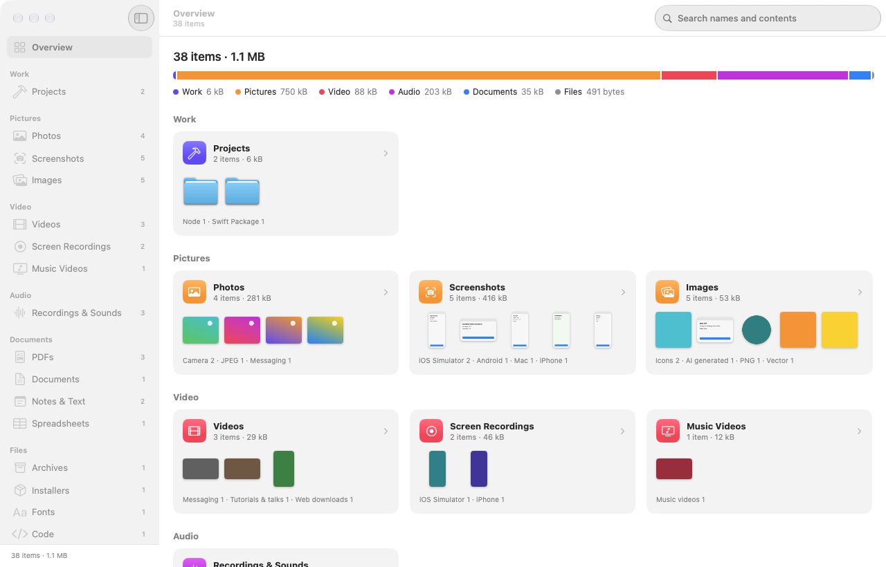

# Vibe Finder

A native macOS app that shows what you have by **what it is**, not by where it is.

Folders nest, and to know what's in them you have to open them one by one. Vibe Finder indexes the
folders you already have (nothing is moved or reorganized) and lets you browse them by kind of
content, with thumbnails, and search them by name or by the text inside.



## What it shows

- **Work**: Projects (the folders of your code projects, by type: Xcode, Swift Package, Gradle, Node…)
  and Apps.
- **Pictures**: Photos, Screenshots (Mac, iPhone, iOS Simulator, Android…) and other Images.
- **Video**: Videos, Screen Recordings and Music Videos.
- **Audio**: Music, and Recordings & Sounds.
- **Documents**: PDFs, Documents, Notes & Text, Spreadsheets, Presentations and Books.
- **Files**: Archives, Installers, Design files, Fonts, loose Code, Keys & Certificates and the rest.

The overview shows how much there is of each kind and the latest few. Each kind opens as a grid of
thumbnails or a list, grouped by date, type or folder, with its subkinds as one-click filters. The
bar at the bottom tells where the selected file lives and how it was recognized. Space previews with
Quick Look, double-click opens, right-click reveals in Finder, and items can be dragged out to other
apps.

Search looks at names and at contents: the text of documents, PDFs, notes and code, and the text read
from screenshots and images.

## How it decides what a file is

1. **Rules first, always.** The file's type, then the naming conventions of the systems and apps
   that create files ("Simulator Screenshot …", `RPReplay_Final…`, "WhatsApp Video …"), the mark
   macOS puts on its own screen captures, and where the file lives.
2. **Then what the file says about itself**: the pixel size of a known screen, a camera model,
   duration and audio tags.
3. **Apple's on-device models only for what's still unclear**: Vision tells a screenshot or a scanned
   document from a drawing, and the on-device language model says what a document is (an invoice, a
   contract, a manual…) or what an unlabeled video is from its name.

Every answer is stored, so the same file keeps its kind until it changes. Everything runs on your
Mac: nothing is sent anywhere. Both the text reading and the models can be turned off in Settings.

## Build

Requires macOS 26 and Xcode 27.

```bash
xcodebuild -project VibeFinder.xcodeproj -scheme VibeFinder -configuration Debug -derivedDataPath build/DerivedData build
```

```bash
scripts/install.sh
```

The first launch asks for permission to read Documents, Desktop and Downloads. Folders are chosen in
Settings.

## Architecture

Clean Architecture, with the dependency rule enforced by module boundaries:

```
VibeFinder/                 the app
  App/                      composition root (AppContainer) and the app's scenes
  Presentation/             view models, SwiftUI views, the AppKit collection view
Packages/FinderCore/
  Sources/FinderDomain/     entities, classification rules, enrichment steps, use cases, ports
  Sources/FinderData/       adapters: file system, SQLite (FTS5) index, ImageIO, AVFoundation,
                            PDFKit, Vision, Foundation Models, FSEvents
  Tests/                    unit tests for both
```

`FinderDomain` imports only Foundation. `FinderData` implements the domain's ports. The app's views
and view models know the domain and nothing else; only `AppContainer` names the adapters.

```bash
cd Packages/FinderCore && swift test
```

## License

MIT. See [LICENSE](LICENSE).
